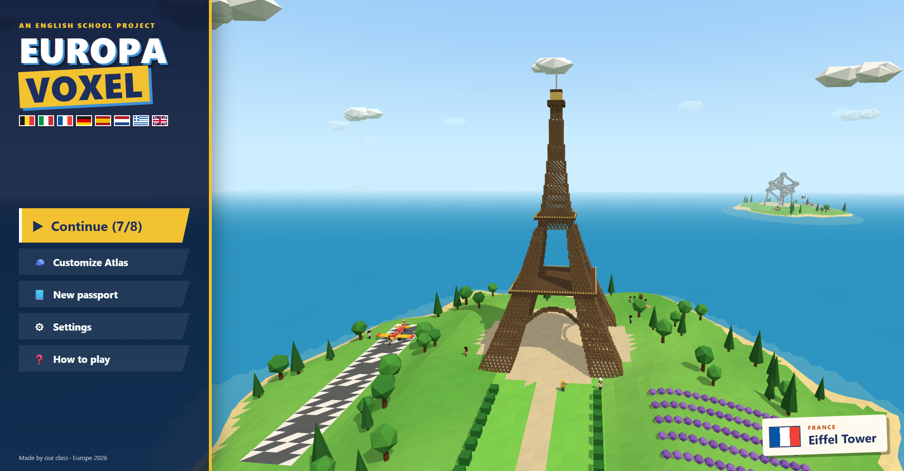
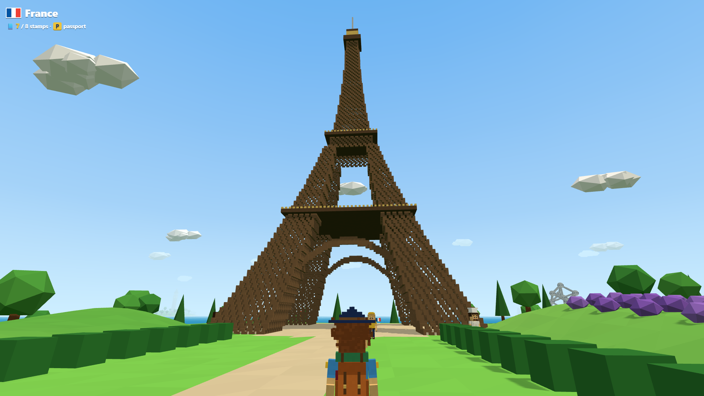
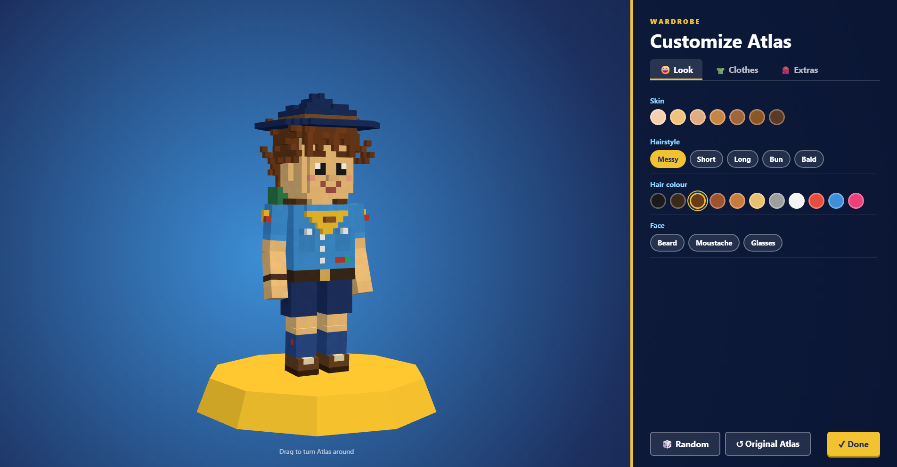
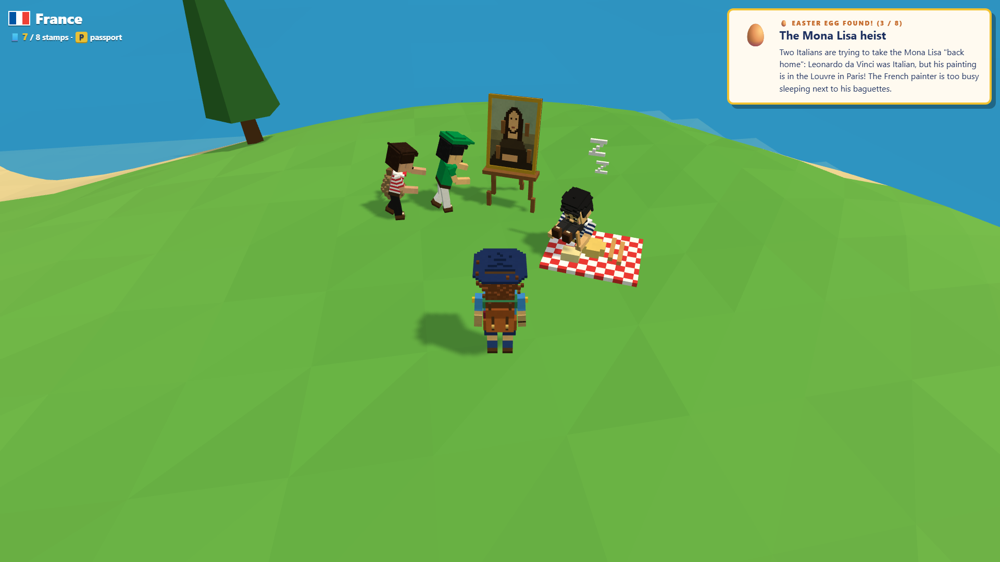
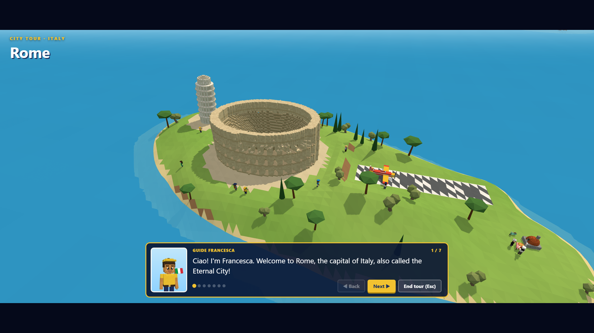
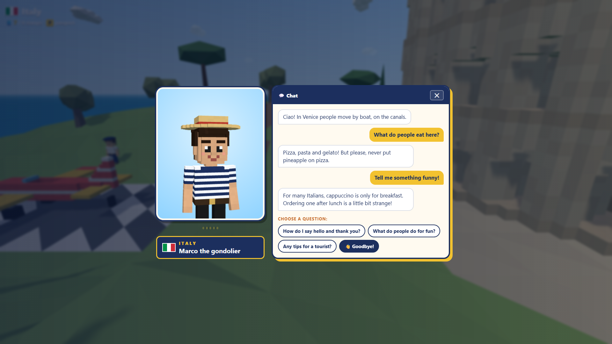
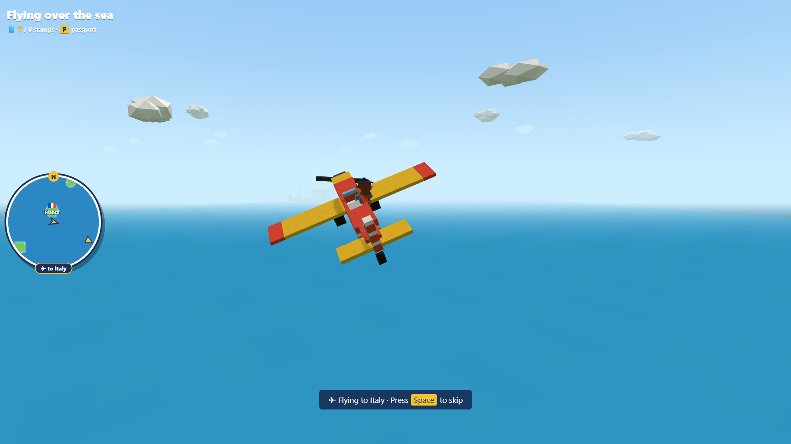
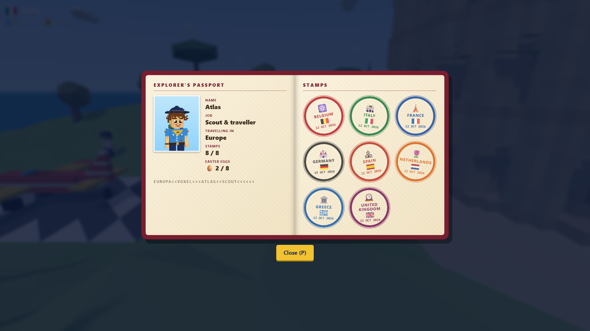
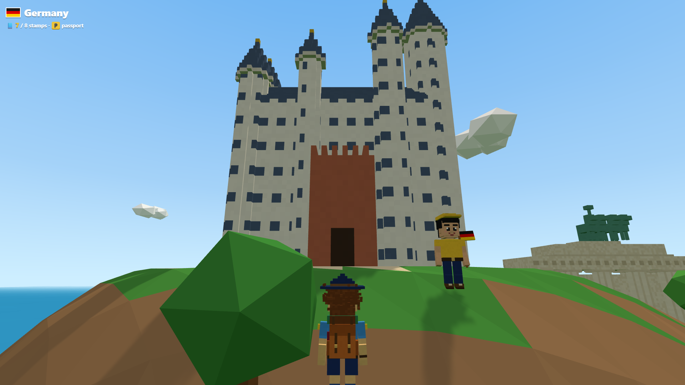

# Europa Voxel

Un videogioco 3D open world in stile voxel per il progetto di **inglese**: con **Atlas**, un giovane scout, si viaggia per 8 paesi d'Europa (ognuno è un'isola), si parla con gli abitanti, si fa il tour della città con la guida, si supera il test e si colleziona il timbro sul passaporto. Tutto il gioco è in inglese.



## Scaricare il gioco

Le versioni pronte si trovano in **[Releases](../../releases/latest)**. Le crea GitHub da solo a ogni modifica su `main`, e ogni sistema ha un solo file:

| Sistema | File | Come si avvia |
|---|---|---|
| Windows | `Europa-Voxel-…-win-x64.exe` | doppio clic, non serve installare niente |
| macOS (Intel e Apple Silicon) | `Europa-Voxel-…-mac-universal.dmg` | apri il `.dmg` e trascina l'app. La prima volta: tasto destro sull'app → **Apri** (l'app non è firmata da Apple) |
| Linux | `Europa-Voxel-…-linux-x86_64.AppImage` | `chmod +x` sul file (oppure Proprietà → Eseguibile), poi doppio clic |

## Come vengono fatte le release

Il workflow [`.github/workflows/release.yml`](.github/workflows/release.yml) parte a ogni push su `main` (le modifiche solo a `.md` o `screenshots/` non contano). In ordine:

1. esegue i test;
2. compila il gioco su Windows, macOS e Linux;
3. pubblica una release `v<versione>-build.<numero>` con i 3 file.

Si può avviare anche a mano: **Actions → Build & release → Run workflow**.

## Sviluppo

```bash
npm install
npm run dev        # gioco nel browser su http://localhost:5173
npm test           # test di voxel, collisioni e rotte delle barche
npm run dist       # .exe per Windows in release/ (in locale)
npm run make-voices  # rigenera le voci inglesi con Kokoro TTS
```

Tutti i testi del gioco (guide, test, abitanti) sono in [`js/data/facts.js`](js/data/facts.js). Gli easter egg sono in [`js/models/eggs.js`](js/models/eggs.js). La documentazione completa del progetto è in [`BRIEFING.md`](BRIEFING.md).

## Screenshot

| | |
|---|---|
|  |  |
|  |  |
|  |  |
|  |  |
